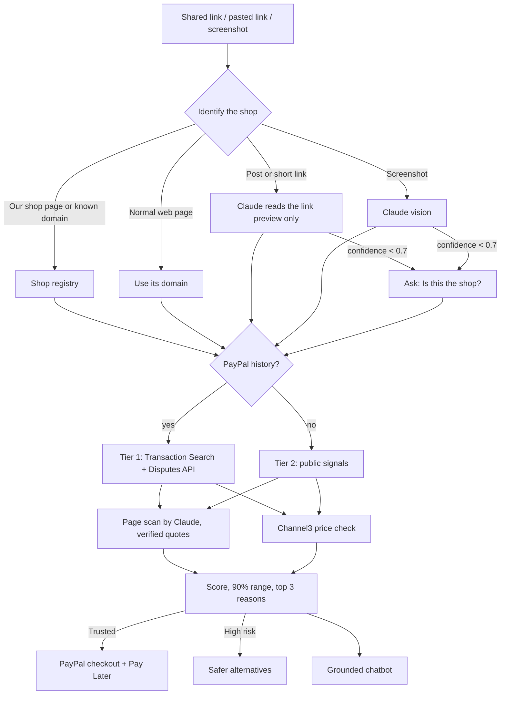

# Vouch

**Reviews can be faked. Payments can't.**

Vouch checks whether an online shop is trustworthy *before* you buy, then lets you buy safely with PayPal. Share a
shop link from your phone, paste one on the web, or upload a screenshot of an ad. Vouch works out which shop it is
and gives a 0–100 trust score with plain-English reasons. When the shop has PayPal payment history, the score is
built from what real buyers actually did: paid, came back, asked for refunds, opened disputes. Trusted shops get a
PayPal checkout with Pay Later; risky shops get safer places to buy the same thing.

Built for the PayPal AI Hackathon.

- **Live demo:** https://vouch-6ilp.onrender.com (see [Try it](#try-it-judges))
- **Licence:** MIT

---

## The problem

Social ads and "link in bio" shops have made it easy to sell to strangers, and easy to fake trust. Reviews,
follower counts and "as seen on" badges can all be bought. Shoppers find out a shop was bad only after they've paid.

What can't be faked cheaply is a payment history: how many real buyers paid, how many came back, how many asked for
their money back or opened a dispute. PayPal already sees that signal. Vouch turns it into a score a shopper can
read in five seconds, at the moment they're deciding whether to buy.

**Who it's for:** people buying from small or unfamiliar online shops, especially from social ads on their phone.

## Try it (judges)

All shops in the demo are fictional and hosted by Vouch. Their PayPal history is real sandbox data.

| Demo | What you'll see |
|---|---|
| [Check Aurora Threads](https://vouch-6ilp.onrender.com/share?from=demo&url=%2Fshops%2Faurora-threads) | **Trusted, 92**: half the buyers came back; PayPal checkout with Pay Later |
| [Check Glowbox](https://vouch-6ilp.onrender.com/share?from=demo&url=%2Fshops%2Fglowbox) | **Use caution, 73**: higher refund rate, store-credit-only returns |
| [Check FlashDeal Outlet](https://vouch-6ilp.onrender.com/share?from=demo&url=%2Fshops%2Fflashdeal-outlet) | **High risk, 13**: a third of orders refunded, 3 disputes lost, fake countdown, 86% below market price; safer alternatives instead of checkout |

Each link starts a fresh check; the result page shows every step live.

Other things to try:

- **[Demo feed](https://vouch-6ilp.onrender.com/feed)**: tap **Share** on a post, or **Vouch** to check it. The fourth post never names
  its shop, so Vouch asks "Is this the shop?".
- **Any real shop link**: paste it on the home page. Without PayPal history you get the clearly labelled
  public-signals score.
- **Screenshot**: upload a screenshot of a product page or ad.
- **Android**: open the site in Chrome, tap **Install Vouch**, then share any link to Vouch from another app.
- **Test checkout** (Aurora Threads or Glowbox): log in with the PayPal sandbox buyer below. No real money moves.

  - Email: `vouch-buyer-7391@personal.example.com`
  - Password: `VouchBuyer2026!`

  This is a PayPal **sandbox** test account with play money, published on purpose for judging. It only works on
  sandbox.paypal.com and cannot be used for real payments.

The server sleeps when idle (free hosting), so the first page load can take up to a minute.

## How it works



A check runs as a background pipeline. Every step is saved as it finishes, so the result page shows live progress:
"Checking with PayPal…", identify, PayPal history, page scan and price check, with the last two running in parallel.
A typical check takes 10–15 seconds.

## PayPal APIs used, and why

All calls use the **sandbox** (`api-m.sandbox.paypal.com`). The code refuses to run with any other `PAYPAL_ENV`.
Each fictional shop is a separate sandbox business account with its own REST app.

| API | Used for |
|---|---|
| **OAuth 2.0** `POST /v1/oauth2/token` | Client-credentials token per shop, cached until expiry |
| **Transaction Search** `GET /v1/reporting/transactions` | The core signal. Last 30 days of sales (`T00xx`) and refunds (`T1107`) with `balance_affecting_records_only=N` so pending refunds count; paginated (`page_size` 500); a look-back in 31-day windows (the API maximum) finds the first sale. `custom_field` and payer account IDs identify distinct and repeat buyers |
| **Disputes** `GET /v1/customer/disputes` (+ details) | Disputes opened and their outcomes; `RESOLVED_BUYER_FAVOUR` / `ACCEPTED` count as lost by the seller |
| **Orders v2** `POST /v2/checkout/orders`, `…/capture`, `GET …/{id}` | Checkout: orders are created and captured **server-side** with the shop's own credentials; the price comes from the shop's catalogue, never the browser. Also used by the seed script (sandbox test card) |
| **Payments v2** `POST /v2/payments/captures/{id}/refund`, `GET /v2/payments/captures/{id}` | Seed script refunds; capture verification |
| **JavaScript SDK v6** (`@paypal/paypal-js`) | `<paypal-button>` and `<paypal-pay-later-button>`, shown only when `findEligibleMethods` says they're eligible, plus **Pay Later messaging** (`<paypal-message>`: "Pay in 4 interest-free payments of $12.00") |

The sandbox data is created by [`scripts/seed-sandbox.ts`](scripts/seed-sandbox.ts): 85 card orders, 14 refunds,
buyer-approved wallet orders and three buyer disputes settled through the sandbox dispute endpoints. See
[docs/SANDBOX_SETUP.md](docs/SANDBOX_SETUP.md).

## AI: models and tools

Model: **Anthropic Claude** via the official TypeScript SDK (`ANTHROPIC_MODEL`, default `claude-opus-5-5`). Every call
uses **structured outputs** (Zod schemas via `messages.parse`), so answers are validated JSON, not free text.
Server-side refusal fallback is enabled on supported models.

| Where | What Claude does | Guardrails |
|---|---|---|
| Shop identification | Reads a shared link's **preview metadata only** (title, description, preview tags) and returns `{shop_name, shop_domain, confidence, evidence}` | Never fetches social platforms; under 70% confidence the user picks the shop |
| Screenshot | **Vision**: product, price, shop name and domain from an uploaded image | Only what's visible; same confirmation step |
| Page scan | Finds risk patterns (fake countdowns, extreme discounts, missing contact details, vague returns, pressure tactics, unrealistic claims) and trust signals, each with **quotes** | Page text is treated as untrusted data; every quote is checked against the page and invented ones are dropped |
| Market query | Turns a shop's (often made-up) product name and claims into a generic search so the price check compares like with like | Brand-free, 3–7 words |
| Chatbot | Answers questions about one check, **only** from that check's data and the shop page | Structured `grounded` flag; anything ungrounded becomes exactly "I don't know from the data I have." Max 10 questions |
| Explanations | Plain-English reasons and summaries | The word "scam" is never used: "high risk" or "unverified" |

Other tools: **Channel3** product search (price comparison and safer alternatives), **RDAP** via the IANA
bootstrap registry (domain age). The code was written with **Claude Code**.

## Scoring

### Tier 1: "Verified by PayPal payments"

Features from the last 30 days of PayPal data: completed payments *n*, problem orders *f* (refunded or disputed,
each order once), distinct buyers *b*, repeat buyers *r*, disputes lost *l*, days since first sale *d*.

1. **Bayesian smoothing.** The problem-order rate gets a Beta prior with mean 0.15 worth 20 orders:
   `p ~ Beta(3 + f, 17 + n − f)`. A shop with 2 sales isn't judged on 2 sales; a shop with 1,000 is judged on its
   data. The repeat-buyer rate gets a Beta(2, 8) prior the same way.
2. **Logistic-style model** (weights in [`src/lib/score/tier1.ts`](src/lib/score/tier1.ts)):

   ```
   z = 1.2 − 10·(p̂ − 0.10) + 3·(q̂ − 0.20) − 8·l/(n + 5) + 0.4·ln(1 + n/20) + 0.3·min(1, d/365)
   score = 100 · sigmoid(z)
   ```

   where p̂ and q̂ are the posterior means.
3. **Uncertainty.** 5,000 Monte Carlo draws from both Beta posteriors give a **90% range** (5th–95th percentile).
   Fewer orders means a wider range.
4. **Reasons.** Each feature's contribution is compared with a typical shop (10% problem orders, 20% repeat buyers),
   and the top three are shown, e.g. "50% of buyers came back to buy again (typical: 20%)".
5. **Labels.** 75+ Trusted, 50–74 Use caution, under 50 High risk. Checkout is offered at 70+.

PayPal data is cached per shop for one hour, and the result shows when it was last updated.

### Tier 2: "No PayPal history: public signals only"

For shops Vouch has no PayPal data for. Logit terms: domain age from RDAP (−2.0 for under 30 days up to +0.8 for
over 10 years), HTTPS, page-scan risks (high −1.2, medium −0.6, low −0.2, total capped at −3), trust signals (+0.35
each, capped), and the price check (−1.5 when the price is under 25% of the market median). The score is **capped at
85**, because public signals can't verify a shop. The range comes from 2,000 draws that also vary each weight by ±35%
and add noise for what public signals can't see, so it is deliberately wide. Labels: "Likely OK (unverified)",
"Unverified", "High risk".

Both models are unit-tested (`npm test`, 54 tests): sampler accuracy, smoothing, monotonicity, range behaviour,
transaction parsing, quote verification, price comparison and alternative ranking.

## Run locally

Requirements: Node 20, a PayPal developer account (sandbox), an Anthropic API key, a Channel3 API key.

```bash
npm install
cp .env.example .env.local    # fill in the keys (see the comments in the file)
npm run seed -- check         # each shop app logs in and is a separate sandbox account
npm run seed                  # create the sandbox payment history (Transaction Search can take up to 3h to show it)
npm run dev                   # http://localhost:3000
```

Sandbox setup, including buyer disputes, is in [docs/SANDBOX_SETUP.md](docs/SANDBOX_SETUP.md). Other commands:

```bash
npm test                                  # unit tests
npx tsx scripts/demo-checks.mts           # run the 3 demo checks against a running server and print every step
```

## Deploying (Render)

[`render.yaml`](render.yaml) is a Render Blueprint for one Node web service with a health check at `/api/health`.
Create the Blueprint from this repo and enter the secrets it asks for. `APP_URL` is optional: the app uses
Render's `RENDER_EXTERNAL_URL` automatically, so set `APP_URL` only for a custom domain.
SQLite lives on the instance's disk (`DATABASE_PATH`); it resets on redeploy, which is fine because checks are
short-lived and all PayPal data comes from the sandbox.

**Keeping the demo awake.** Free Render services spin down after 15 minutes without traffic and take about a minute
to wake. Either use a paid instance, or ping `/api/health` every 10 minutes from an uptime monitor or a scheduled job.
The health endpoint makes no external calls.

## Known limitations

- **Sandbox history is young.** Sandbox transactions are always dated "now", so every demo shop's trading history
  starts on the day it was seeded. Trading history is a small part of the score.
- **Transaction Search lag.** New PayPal transactions take up to 3 hours to appear, so a new sale doesn't change a
  score immediately.
- **Registry of three.** Only the three demo shops have PayPal credentials in Vouch. Every other shop is scored on
  public signals.
- **Public signals are weak.** Tier 2 can be fooled by a well-written page on an old domain. That's why it's capped
  and labelled "unverified".
- **Single instance.** Rate limits and caches are in memory and SQLite on one server.
- **Alternatives** are similar products, not always the identical item, and their retailers are labelled only by
  domain age.

## Production vision

In production, Vouch wouldn't need each shop's API credentials. PayPal could compute these features across its own
merchant base and expose a privacy-preserving **merchant trust signal**: aggregate rates and ranges, never individual
transactions. Vouch's model, explanations and checkout flow would sit on top of that. The same score could power a
"Verified by PayPal payments" badge that shops embed, and a warning in PayPal checkout before a buyer pays a
high-risk merchant. The two-tier design keeps unknown shops clearly labelled as unverified instead of guessing.

## Project structure

```
src/app/            pages and API routes (/share, /check/[id], /api/check/*, /api/checkout/*, /api/health)
src/lib/paypal/     PayPal REST client, Transaction Search + Disputes history, feature extraction
src/lib/score/      Tier 1 and Tier 2 models, statistics helpers (tested)
src/lib/ai/         Claude calls: identification, page scan, market query, chatbot
src/lib/check/      check pipeline and result types
scripts/            sandbox seed script, demo-check runner, icon generator
docs/               sandbox setup
```

## Licence

[MIT](LICENSE)
